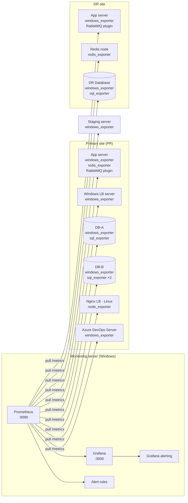
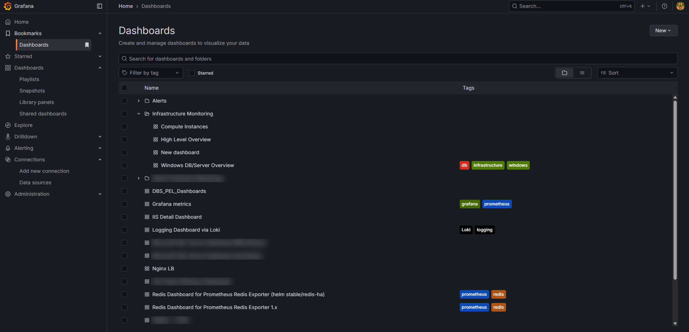
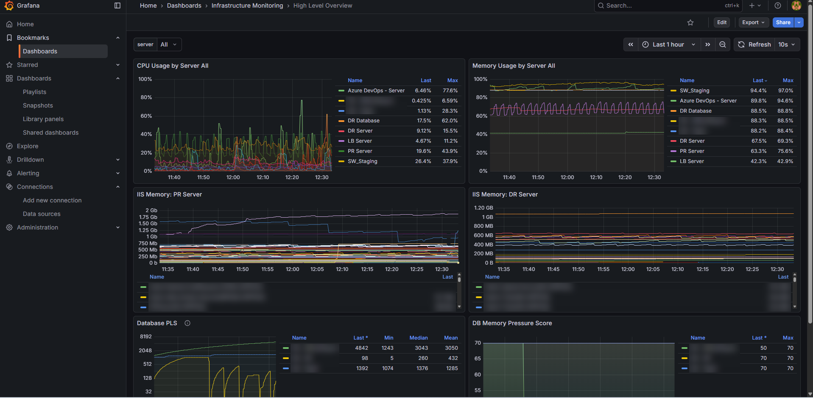

# 📈 Infrastructure Monitoring with Prometheus & Grafana

> End-to-end observability for a payments platform running across **primary (PR) and disaster-recovery (DR) sites**: Windows application and database servers, SQL Server, an Nginx load balancer, Redis Sentinel, RabbitMQ, and the CI/CD server, all monitored from one Prometheus + Grafana stack with alerting thresholds.


> ℹ️ Sanitized write-up of a production setup. IP addresses, hostnames, database names, and application names are replaced or blurred.

---

## 📑 Table of Contents

1. [Overview](#1-overview)
2. [Why It Was Needed](#2-why-it-was-needed)
3. [Architecture](#3-architecture)
4. [Exporters & What They Collect](#4-exporters--what-they-collect)
5. [Prometheus Configuration](#5-prometheus-configuration)
6. [Grafana Dashboards](#6-grafana-dashboards)
7. [Alerting Thresholds](#7-alerting-thresholds)
8. [Monitoring SQL Server Properly](#8-monitoring-sql-server-properly)
9. [Challenges & Solutions](#9-challenges--solutions)
10. [Repository Structure](#10-repository-structure)
11. [Future Improvements](#11-future-improvements)

---

## 1. Overview

| | |
|---|---|
| **Hosts monitored** | 10 hosts: PR & DR app servers, 3 SQL Server hosts, Windows & Linux load balancers, DR Redis node, staging, CI/CD server |
| **Scrape targets** | ~20 across Windows, SQL Server, Linux, Redis, and RabbitMQ |
| **Stack location** | Prometheus and Grafana on a Windows application server |
| **Scrape interval** | 30 s |
| **Dashboards** | High-level overview, compute instances, Windows DB/server, IIS detail, SQL Server per database host, Nginx LB, Redis, RabbitMQ (PR/DR), helpdesk, Loki logs |
| **Alerting** | CPU, memory, disk, target down, Redis down, RabbitMQ alarms, queue backlog, queues without consumers |

## 2. Why It Was Needed

**Before:** there was no central view of server health. Checking a server meant logging in over RDP and opening Task Manager or Performance Monitor one machine at a time. Problems like a full disk, a memory-hungry app pool, or a stopped consumer were usually found **after** they had already affected transactions.

**After:**
- One dashboard shows CPU, memory, and disk for **every server in both sites** at a glance.
- **Per-app-pool memory** on IIS shows exactly which service is growing, not just that "the server is slow".
- **SQL Server health** is tracked with database-specific signals (page life expectancy, memory pressure), not just OS memory.
- **Message-queue and cache health** (RabbitMQ, Redis) are visible next to the servers they run on.
- **Thresholds alert the team before users notice**, e.g. a drive dropping below 10%, or a queue building up with no consumers.

## 3. Architecture



- **Pull model:** Prometheus scrapes every exporter over HTTP. Exporters need only one inbound firewall rule from the monitoring server.
- **Labels carry the topology:** each target has `site` (PR / DR / STG) and `role` (app / db / lb / devops), so dashboards and alerts can filter or group by site or server type without hard-coding host names.

## 4. Exporters & What They Collect

| Exporter | Port | Hosts | Key metrics |
|---|---|---|---|
| **windows_exporter** | 9182 | All Windows servers | CPU, memory, page file, logical disks, network, services, processes (per-app-pool memory) |
| **sql_exporter** | 9399 / 9978–9980 | SQL Server hosts | Page life expectancy, memory pressure, connections, waits, database size |
| **node_exporter** | 9100 | Nginx load balancer (Linux) | CPU, memory, disk, network |
| **redis_exporter** | 9121 | Redis Sentinel nodes (PR & DR) | Up/down, memory, connected clients, ops/sec, replication |
| **rabbitmq_prometheus** (built-in plugin) | 15692 | RabbitMQ nodes (PR & DR) | Alarms, connections, message rates, per-queue depth and consumers |

**windows_exporter config:** [`windows_exporter/config.yaml`](windows_exporter/config.yaml)

```yaml
collectors:
  enabled: "cpu,memory,pagefile,logical_disk,net,os,service,system,time,diskdrive,process"
```

Only the collectors that feed dashboards and alerts are enabled. This keeps scrapes fast on busy production servers. `scrape.timeout-margin` gives the exporter headroom to finish before Prometheus times out.

## 5. Prometheus Configuration

📄 [`prometheus/prometheus.yml`](prometheus/prometheus.yml) · 📄 [`prometheus/rules/infrastructure-alerts.yml`](prometheus/rules/infrastructure-alerts.yml)

Jobs are split **by exporter type**, not by host:

| Job | Exporter | Why separate |
|---|---|---|
| `windows` | windows_exporter | Same metric family across all Windows hosts |
| `mssql` | sql_exporter | DB hosts run both windows_exporter and sql_exporter. Separate jobs keep their `up` series and labels from colliding |
| `linux` | node_exporter | Different metric names from Windows |
| `redis` | redis_exporter | |
| `rabbitmq` / `rabbitmq_detailed` | RabbitMQ plugin | `/metrics` for broker totals, `/metrics/detailed` for per-queue depth and consumers |

Both files are validated with `promtool check config` and `promtool check rules`.

## 6. Grafana Dashboards



| Dashboard | Purpose |
|---|---|
| **High Level Overview** | One-screen health of all servers: CPU and memory per server, IIS memory per app pool (PR & DR), SQL page life expectancy, DB memory pressure |
| **Compute Instances** | Per-server drill-down via a `server` variable |
| **Windows DB/Server Overview** | OS-level health of database hosts |
| **IIS Detail** | Per-site and per-app-pool resource usage |
| **SQL Server** (one per DB host) | Database engine metrics from sql_exporter |
| **Nginx LB** | Load balancer host metrics |
| **Redis** | Sentinel nodes on PR and DR |
| **RabbitMQ (PR / DR)** | Broker health, rates, queue depth, consumers per queue |
| **Helpdesk (Znuny)** | Ticket intake/closure from the ITSM database (see the Znuny project) |
| **Logs via Loki** | Centralised log exploration alongside metrics |

**High Level Overview**



Design choices:
- **Legends as tables with Last / Max**, so the busiest server is readable without hovering.
- A **`server` template variable** (default *All*) lets the same dashboard zoom into one host.
- **Log-scale y-axis for page life expectancy**, because values range from single digits (memory pressure) to thousands (healthy).

## 7. Alerting Thresholds

| Alert | Condition | For | Severity |
|---|---|---|---|
| `TargetDown` | `up == 0` (host or exporter unreachable) | 2 m | critical |
| `HighCPU` | CPU > **90%** | 10 m | warning |
| `HighMemory` | Memory > **90%** (non-DB hosts) | 10 m | warning |
| `LowDiskSpace` | Free < **10%** on any drive | 5 m | warning |
| `CriticalDiskSpace` | Free < **5%** on any drive | 2 m | critical |
| `RedisDown` | `redis_up == 0` | 1 m | critical |
| `RabbitMQResourceAlarm` | Memory or disk watermark hit (publishers blocked) | 1 m | critical |
| `RabbitMQQueueBacklog` | > **1,000** ready messages in a queue | 10 m | warning |
| `RabbitMQQueueNoConsumers` | Queue has **0 consumers** | 5 m | warning |

**Why the `for:` windows:** short spikes (a backup job, a deployment) are normal. Alerting only when a condition persists keeps the signal meaningful, so the team doesn't learn to ignore alerts.

**Why the 5% disk threshold matches CI/CD:** the deployment pipeline's own health check refuses to deploy below 5% free disk, so the alert fires at 10%, before releases start getting blocked.

## 8. Monitoring SQL Server Properly

The overview dashboard shows the database servers sitting at **~88% memory all the time**. That's **expected**: SQL Server reserves memory for its buffer pool up to `max server memory` and keeps it. Alerting on OS memory for DB hosts would fire permanently.

So database hosts are:
- **excluded** from the generic `HighMemory` alert (`role!="db"`), and
- monitored through **SQL-specific signals** from sql_exporter:
  - **Page Life Expectancy (PLE):** how long a data page stays in the buffer pool. A sudden collapse means SQL is under real memory pressure and is reading from disk.
  - **Memory pressure score:** a composite indicator shown next to PLE on the overview.

This is the difference between "the server looks full" and "the database is actually struggling".

## 9. Challenges & Solutions

| Challenge | Solution |
|---|---|
| **Three network segments** (PR, DR, DB subnets) | Exporter ports opened from the monitoring server into each segment, so one Prometheus covers every site |
| **Several exporters on one DB host** shared the same `instance` label in one job, so their `up` series overlapped | Split into `windows` and `mssql` jobs with distinct instance labels |
| **DB servers always looked "out of memory"** | Excluded DB hosts from OS-memory alerts; used PLE and memory pressure instead |
| **Server-level memory hid the real culprit** | Process collector exposes memory per IIS app pool, so a leaking service is visible directly |
| **Heavy collectors slowing scrapes** on production servers | Enabled only the needed collectors; set an exporter `timeout-margin` |
| **RabbitMQ per-queue metrics** aren't in the default endpoint | Separate job scraping `/metrics/detailed` with only the queue families needed |

## 10. Repository Structure

```
Infrastructure-Monitoring-Prometheus-Grafana/
├── README.md
├── prometheus/
│   ├── prometheus.yml                    # scrape jobs by exporter type, site/role labels
│   └── rules/
│       └── infrastructure-alerts.yml     # availability, host, Redis, RabbitMQ alerts
├── windows_exporter/
│   └── config.yaml                       # enabled collectors and listener
└── docs/screenshots/
```

## 11. Future Improvements

- **Alertmanager** with routing by severity: critical alerts to on-call chat, warnings to email, and alert emails into the **Znuny DevOps queue** so every alert becomes a tracked ticket.
- **blackbox_exporter** for external vendor and bank API reachability (HTTP/TCP probes with latency).
- **Application metrics** from the .NET services (`prometheus-net`): request rate, error rate, latency, and scheduler job health.
- **SQL Server alerts** on PLE drops, blocking, and failed jobs.
- **Dashboards as code:** provision dashboards and data sources from JSON/YAML so the stack can be rebuilt in minutes.
- Move the load balancer scrape to a **private network path** and enable TLS + basic auth on exporters.

---

**Author:** Hussain Malik
